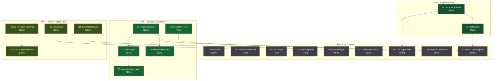

# Pareto Plan: release trust, gate parity, and the v0.5.0 consumer rollout

**Created:** 2026-11-27 22:49 CET · Crush session (docs-health audit + corpus
archive) · basis: `TODO_LIST.md` (harvested 2026-11-27), the two 2026-11-27
status reports `15-32` and `16-16`, and this session's status report
`2026-11-27_16-49_docs-health-audit-corpus-archive-and-living-doc-rebuild.md`.

**State at planning time:** `master` at `6e2316b` plus an uncommitted
docs-health pass (32 files: living docs, corpus archive, one ADR, CI docs
step). `docs-gates run .` is 10/10 green, `nix run .#check-docs` green, Go
suite 96.7%, lint 0, actionlint 0, `nix build` green on a dirty tree.
`govulncheck` and `nix flake check --no-build --all-systems` are unrun.
`v0.5.0` is tagged; `nextd` and project-discovery-daemon still consume
v0.4.0.

**Customer:** the two consumers (`project-discovery-daemon` today, `nextd`
next) plus the owner's release trust in a newly public repository. Value =
adoption of v0.5.0 without a wire-shape surprise, gates that fail before a
push instead of after, and a documented corpus that cannot rot silently.

**The v0.5.0 risk in one sentence:** the default JSON codec now emits
json/v2 shapes (nil slice `[]`, `time.Duration` encode error, unordered map
keys), so every consumer with a duration or nil-slice DTO is a latent
production break until it audits and pins a codec.

---

## Pareto breakdown

### The 1% that delivers 51%: make v0.5.0 adoptable

Two consumer upgrades and their DTO audits. Nothing else in this plan
matters to a user of the library until the version they import is verified
against their own structs. The pdd audit is the release's real risk; the
`nextd` floor bump is the dependency-graph unblock. Everything else is
internal quality.

- **T1** pdd: audit `time.Duration`/nil-slice DTOs, bump to v0.5.0, re-derive
  `vendorHash`, run its suite.
- **T2** `nextd`: bump go-daemon v0.4.0 → v0.5.0, raise `go` to 1.27.2.

### The 4% that delivers 64%: make the next release verifiable

The two 2026-11-27 reports both record red pushes caused by gates a session
forgot to run, and a release tagged while CI was suspended. The fix is one
local target equal to CI plus a tag-triggered workflow, then a clean-tree
verification of the tag.

- **T3** `scripts/release-check.sh` (one command, one verdict).
- **T4** `.github/workflows/release.yml` (tag-triggered release gates).
- **T5** the full `docs-gates` battery in CI (freshness/annotate/routing/
  cadence, not only `check-docs`).
- **T6** `govulncheck` and `actionlint` as flake apps, with a recorded
  baseline.
- **T7** clean-tree, all-systems, tagged-tree verification.

### The 20% that delivers 80%: close the contract edges the audit exposed

The docs audit named a latent panic (`WriteEncoded(..., nil, ...)`), an
unpinned default-codec wire contract, and missing examples/fuzz for the v0.5.0
surface. These are small, bounded, and customer-visible.

- **T8** default-codec wire-shape test + nil-codec guard/contract.
- **T9** godoc examples, `JSONv2Codec` nil-option test, injected-codec fuzz.

### The other 20% to reach 100%

Security operations on a public repo (CodeQL, branch protection, secret
patterns, deploy key), the DiscordSync adoption driver (deferrable READY),
public presence, test-depth hardening, cross-repo hygiene, quality ledgers,
invariant/benchmark anchors, corpus maintenance, pdd ergonomics, and the
release-presentation policy.

---

## Level 1: comprehensive plan (30–100 min tasks, ALL TODOs)

Sorted by impact/customer value, then dependency order. `Exec` is the
recommended execution order.

| ID  | Task                                                                                                  | Pareto | Exec | Impact      | Effort | Customer value                               | Depends on |
| --- | ----------------------------------------------------------------------------------------------------- | ------ | ---- | ----------- | ------ | -------------------------------------------- | ---------- |
| T1  | pdd: DTO audit (`time.Duration`, nil slices), bump v0.5.0, vendorHash, suite                          | 1%     | 1    | Critical    | 90m    | Adoption unblocked; wire break prevented     | —          |
| T2  | `nextd`: bump go-daemon v0.5.0 + `go 1.27.2`                                                          | 1%     | 2    | High        | 45m    | Dependency graph current                     | —          |
| T3  | `scripts/release-check.sh`, one local target equal to the CI set                                      | 4%     | 3    | Critical    | 90m    | No more red pushes                           | —          |
| T4  | `.github/workflows/release.yml`, tag-triggered release gates                                          | 4%     | 4    | High        | 60m    | Tagged releases are machine-verified         | T3         |
| T5  | Full `docs-gates` battery in CI (flake input/app or pinned `nix run`)                                 | 4%     | 5    | High        | 75m    | Docs cannot rot for two months again         | —          |
| T6  | `govulncheck` + `actionlint` flake apps, recorded baseline                                            | 4%     | 6    | High        | 60m    | Local and CI commands match                  | —          |
| T7  | Clean-tree + all-systems + tagged-tree verification                                                   | 4%     | 7    | High        | 45m    | Release evidence is real, not dirty-tree     | T3, T4     |
| T8  | Default-codec wire-shape test + nil-codec contract (`WriteEncoded`, `ContentTypeFor`)                 | 20%    | 8    | High        | 75m    | No latent panic; wire contract pinned        | —          |
| T9  | v0.5.0 adoption surface: godoc examples, nil-option test, injected-codec fuzz                         | 20%    | 9    | Medium      | 90m    | Faster, safer consumer adoption              | T8         |
| T10 | Public-repo security ops: CodeQL, branch/tag protection, secret patterns, deploy key, consumer secret | 20%    | 10   | High        | 90m    | Public exposure is governed                  | —          |
| T11 | Deferrable READY option (DiscordSync adoption driver)                                                 | 20%    | 11   | Medium-high | 90m    | Removes the last functional adoption gap     | —          |
| T12 | Store front: badge verification, homepage, "public since" line, announcement decision                 | other  | 12   | Low-medium  | 60m    | Discoverability                              | —          |
| T13 | Toolchain/security follow-up: flake Go 1.27.4, govulncheck record, cross-compile sweep                | other  | 13   | Medium      | 45m    | DevShell stops reporting the stdlib CVE      | —          |
| T14 | Test-depth hardening: watchdog flake, `-shuffle`, nightly `-count=15`                                 | other  | 14   | Medium      | 75m    | Timing regressions found before users        | —          |
| T15 | Cross-repo hygiene: SystemNix lock, worktrees, Dependabot check, consumer-smoke script                | other  | 15   | Medium      | 75m    | No stale private pins; releases smoke-tested | —          |
| T16 | Quality ledgers: art-dupl baseline, erraudit baseline, bare-assertion sweep, branching-flow decision  | other  | 16   | Medium      | 90m    | Findings are dismissed by reference          | —          |
| T17 | Invariant/benchmark anchors: 3 benchmarks, sd_notify golden, pool assertion                           | other  | 17   | Low-medium  | 90m    | Numbers replace hunches                      | —          |
| T18 | Corpus maintenance: manifest provenance, ledger convention in AGENTS                                  | other  | 18   | Medium      | 45m    | Next archive pass knows the convention       | —          |
| T19 | pdd ergonomics: Vary adoption, `ClassifyTransportError`, `WriteErrorfWithCodec`                       | other  | 19   | Medium      | 90m    | Consumer uses the shipped contract           | T1         |
| T20 | Release presentation policy: v0.5.0 note, prerelease/Latest, v0.4.x support                           | other  | 20   | Low         | 45m    | One documented answer, not a debate          | —          |

**Totals:** 20 tasks, ~23.5 h scheduled. Critical path for adoption:
T1 → T19. Critical path for release trust: T3 → T4 → T7.

---

## Level 2: detailed breakdown (≤12 min per subtask, ALL TODOs)

Sorted by execution order; subtasks within a task in dependency order.
`Gate` is the acceptance check. Every subtask is at most 12 minutes.

| #   | Subtask                                                                  | Task | Est | Gate / acceptance                     |
| --- | ------------------------------------------------------------------------ | ---- | --- | ------------------------------------- |
| 1   | Read pdd `go.mod` + flake pin; record the current v0.4.0 state           | T1   | 6m  | Notes: version, hash, CI state        |
| 2   | Grep pdd DTOs for `time.Duration` JSON fields                            | T1   | 12m | List of files/fields                  |
| 3   | Grep pdd DTOs for nil-slice/pointer fields encoded as JSON               | T1   | 12m | List of files/fields                  |
| 4   | Build pdd against v0.5.0 through a `replace` directive                   | T1   | 12m | `go build ./...` green                |
| 5   | Run pdd tests under the replace directive; triage failures               | T1   | 12m | Failure list with verdicts            |
| 6   | Bump pdd `go.mod` to v0.5.0 + tidy; fix any compile breaks               | T1   | 12m | `go test` green                       |
| 7   | Re-derive pdd `vendorHash` with `buildflow -s nix-hash-fix --fix`        | T1   | 12m | `nix build` green                     |
| 8   | Commit pdd bump descriptively; push and watch CI                         | T1   | 6m  | CI green or billing noted             |
| 9   | Read `nextd/go.mod`; confirm go-daemon v0.4.0 + `go 1.27.1`              | T2   | 6m  | Notes recorded                        |
| 10  | `go get go-daemon@v0.5.0`; set `go 1.27.2`; tidy                         | T2   | 12m | `go.mod` diff only                    |
| 11  | Build + test `nextd`; fix compile breaks                                 | T2   | 12m | Suite green                           |
| 12  | Re-derive a hash if `nextd` is nix-built; commit + push                  | T2   | 12m | Build green; pushed                   |
| 13  | Inventory every CI step into a release-check checklist                   | T3   | 6m  | Checklist matches `ci.yml`            |
| 14  | Create `scripts/release-check.sh` with `set -euo pipefail` and step echo | T3   | 12m | Script runs to end                    |
| 15  | Add build, vet, race tests, coverage gate, README snippet                | T3   | 12m | Local run green                       |
| 16  | Add lint + actionlint + govulncheck                                      | T3   | 12m | Local run green (CVE noted)           |
| 17  | Add `nix build` + `nix flake check --no-build --all-systems`             | T3   | 12m | Local run green                       |
| 18  | Add `check-docs` and the `docs-gates` battery                            | T3   | 12m | Local run green                       |
| 19  | Wrap as a flake app; document in AGENTS/CONTRIBUTING                     | T3   | 12m | `nix run .#gate` works                |
| 20  | Negative-test the script (break a gate, restore) and commit              | T3   | 12m | Exit 1 then exit 0                    |
| 21  | Draft `release.yml` on `push: tags: v*`                                  | T4   | 12m | actionlint clean                      |
| 22  | Reuse the release-check steps in the workflow                            | T4   | 12m | Workflow diff reviewed                |
| 23  | Run it via `workflow_dispatch` on a branch                               | T4   | 12m | Green run recorded                    |
| 24  | Document the tag flow in CONTRIBUTING/AGENTS                             | T4   | 6m  | Docs gate green                       |
| 25  | Choose docs-gates provisioning (flake input vs pinned `nix run`)         | T5   | 12m | Decision recorded                     |
| 26  | Wire the chosen provisioning into the flake                              | T5   | 12m | `nix run .#docs-gates -- run .` works |
| 27  | Add the battery to the CI nix job                                        | T5   | 6m  | actionlint clean                      |
| 28  | Run the battery on the current tree; fix findings                        | T5   | 12m | 10/10 PASS                            |
| 29  | Document the command and the corpus convention                           | T5   | 6m  | AGENTS updated                        |
| 30  | Add `govulncheck` and `actionlint` flake apps                            | T6   | 12m | `nix run .#vuln`, `.#actionlint` work |
| 31  | Run `govulncheck`; record the CVE and its toolchain condition            | T6   | 12m | Report line added                     |
| 32  | Run `actionlint`; record clean                                           | T6   | 6m  | Output captured                       |
| 33  | Add both to `release-check.sh`                                           | T6   | 6m  | Gate list updated                     |
| 34  | Document the expected 1.27.3 finding                                     | T6   | 6m  | AGENTS/TODO note                      |
| 35  | Make the descriptive docs commit (baseline for verification)             | T7   | 6m  | Clean tree                            |
| 36  | `nix build .#default` on the clean commit                                | T7   | 12m | Store path recorded                   |
| 37  | `nix flake check --no-build --all-systems`                               | T7   | 12m | Green                                 |
| 38  | Verify the v0.5.0 tag's tree still builds and tests                      | T7   | 12m | Worktree run green                    |
| 39  | Record the evidence in TODO/status                                       | T7   | 6m  | Evidence link                         |
| 40  | Probe and record the default codec's three wire shapes                   | T8   | 12m | Probe output saved                    |
| 41  | Add `TestDefaultJSONCodec_WireShapes`                                    | T8   | 12m | Test fails if a shape drifts          |
| 42  | Decide the nil-codec contract (guard vs documented panic)                | T8   | 12m | Decision noted                        |
| 43  | Implement the guard/doc + tests for `WriteEncoded`/`WriteErrorf`         | T8   | 12m | Tests green                           |
| 44  | Align `ContentTypeFor` nil/unknown-codec behavior                        | T8   | 12m | Test green                            |
| 45  | CHANGELOG + gate + commit                                                | T8   | 12m | Full gate green                       |
| 46  | Write `ExampleJSONv2Codec`                                               | T9   | 12m | Output-verified example               |
| 47  | Write `ExampleWriteJSONWithCodec` / `ExampleWriteErrorfWithCodec`        | T9   | 12m | Output-verified examples              |
| 48  | Add the nil-option-element test for `JSONv2Codec`                        | T9   | 12m | Test pins the behavior                |
| 49  | Extend `FuzzResolveResponseCodec` with injected codecs                   | T9   | 12m | Fuzz target compiles                  |
| 50  | Soak the new fuzz dimension for 60s                                      | T9   | 6m  | No crashers                           |
| 51  | Gate + docs + commit                                                     | T9   | 12m | Full gate green                       |
| 52  | Enable CodeQL default setup                                              | T10  | 12m | CodeQL run scheduled                  |
| 53  | Enable branch/tag protection requiring CI                                | T10  | 12m | `gh` ruleset recorded                 |
| 54  | Enable non-provider secret patterns; confirm zero alerts                 | T10  | 12m | Alerts list empty                     |
| 55  | Delete the `systemnix-ci-readonly` deploy key                            | T10  | 12m | `gh` list confirms gone               |
| 56  | Verify and delete the stale consumer deploy-key secret                   | T10  | 12m | Verified or permission noted          |
| 57  | Record the security posture in the decision record/TODO                  | T10  | 6m  | Evidence linked                       |
| 58  | Design the deferrable-READY option shape                                 | T11  | 12m | Option name/semantics written         |
| 59  | Implement the option (suppress built-in `NotifyReady`)                   | T11  | 12m | Compiles                              |
| 60  | Test the suppress path (no READY without the hook)                       | T11  | 12m | Test green                            |
| 61  | Test the default path unchanged                                          | T11  | 12m | Test green                            |
| 62  | Example + CHANGELOG + FEATURES row                                       | T11  | 12m | Docs gate green                       |
| 63  | Update the DiscordSync feedback doc's revisit bar                        | T11  | 12m | Doc reflects shipped state            |
| 64  | Fetch the CI and pkg.go.dev badge URLs                                   | T12  | 6m  | HTTP 200 recorded                     |
| 65  | Set the repository homepage                                              | T12  | 6m  | `gh repo view` shows it               |
| 66  | Add the "public since 2026-11-27" README line                            | T12  | 6m  | check-readme green                    |
| 67  | Decide the announcement (none/README line/docs site)                     | T12  | 12m | Decision recorded                     |
| 68  | Re-check nixpkgs Go 1.27.4                                               | T13  | 6m  | `nix eval` result recorded            |
| 69  | Bump the flake's Go when available                                       | T13  | 12m | `nix build` green                     |
| 70  | Re-run `govulncheck` after the bump                                      | T13  | 12m | Finding gone                          |
| 71  | Re-run the cross-compile sweep at the new toolchain                      | T13  | 12m | Matrix updated                        |
| 72  | Update AGENTS' cross-compile footnote                                    | T13  | 6m  | Docs gate green                       |
| 73  | Reproduce the watchdog timing flake                                      | T14  | 12m | Failing run captured                  |
| 74  | Fix the assertion (poll-based or budget)                                 | T14  | 12m | 100 iterations green                  |
| 75  | Add `-shuffle=on` to CI tests                                            | T14  | 6m  | actionlint clean                      |
| 76  | Add the nightly `-count=15` schedule                                     | T14  | 12m | Workflow exists                       |
| 77  | Run `-count=15` locally once                                             | T14  | 12m | Green or findings triaged             |
| 78  | Float SystemNix's lock                                                   | T15  | 12m | No nested go-daemon input             |
| 79  | Confirm the nested input is gone in the lock diff                        | T15  | 6m  | grep clean                            |
| 80  | Clean the stale worktrees under the sibling rows directory               | T15  | 12m | `git worktree list` clean             |
| 81  | Re-check Dependabot opens PRs on the public repo                         | T15  | 6m  | One PR or config note                 |
| 82  | Add `scripts/consumer-smoke.sh`                                          | T15  | 12m | Script runs against v0.5.0            |
| 83  | Wire the smoke script into `release-check.sh`                            | T15  | 6m  | Gate list updated                     |
| 84  | Run `art-dupl -t 1` and record the accepted group                        | T16  | 6m  | Exactly one finding                   |
| 85  | Write the art-dupl baseline gate script                                  | T16  | 12m | Exit 1 on a new clone                 |
| 86  | Wire the baseline into `release-check.sh`                                | T16  | 6m  | Gate list updated                     |
| 87  | Pin the erraudit known-dismissed baseline in an artifact                 | T16  | 12m | File exists; AGENTS links it          |
| 88  | Sweep bare type assertions; triage every hit                             | T16  | 12m | Verdict list                          |
| 89  | Record the sync.Pool assertion idiom + branching-flow verdict in AGENTS  | T16  | 12m | Docs gate green                       |
| 90  | Decide branching-flow adopt/reject                                       | T16  | 12m | Decision recorded                     |
| 91  | Add the pooled-buffer write benchmark                                    | T17  | 12m | `go test -bench` runs                 |
| 92  | Add the `JSONv2Codec` benchmark                                          | T17  | 12m | Differential recorded                 |
| 93  | Add the SSE line-reader benchmark                                        | T17  | 12m | Allocation count recorded             |
| 94  | Add the sd_notify message-sequence golden test                           | T17  | 12m | Test pins order                       |
| 95  | Assert pool reuse in `TestWriteEncoded_JSONAndCBOR`                      | T17  | 12m | Test green                            |
| 96  | Gate + commit the anchors                                                | T17  | 6m  | Full gate green                       |
| 97  | Append this session to the archive manifest's provenance                 | T18  | 6m  | Manifest updated                      |
| 98  | Add the §f-ledger convention to AGENTS                                   | T18  | 12m | Docs gate green                       |
| 99  | Re-run the battery after the docs change                                 | T18  | 6m  | 10/10 PASS                            |
| 100 | Update TODO provenance to the latest harvest                             | T18  | 6m  | Header accurate                       |
| 101 | Plan pdd `Vary: Accept` adoption                                         | T19  | 12m | Change scoped                         |
| 102 | Replace pdd's private transport classifier with `ClassifyTransportError` | T19  | 12m | Compiles                              |
| 103 | Switch pdd error writes to `WriteErrorfWithCodec`                        | T19  | 12m | Compiles                              |
| 104 | Build/test pdd; commit and push                                          | T19  | 12m | Suite green                           |
| 105 | Decide whether v0.5.0's release notes mention public availability        | T20  | 6m  | Decision recorded                     |
| 106 | Record the prerelease/Latest policy                                      | T20  | 12m | CONTRIBUTING or release doc           |
| 107 | Record the v0.4.x support policy                                         | T20  | 6m  | SECURITY.md consistent                |
| 108 | Update README/CHANGELOG with the decided lines                           | T20  | 6m  | Docs gate green                       |

**Totals:** 108 subtasks, ~19.5 h estimated, none over 12 minutes. The
critical path for adoption is 1→8 (pdd) and 9→12 (`nextd`); for release trust
it is 13→20 (script), 21→24 (workflow), 35→39 (verification).

---

## Execution graph

---

## Verschlimmbesserung guardrails

1. **Never re-tag or move `v0.5.0`.** A released wire shape is a contract;
   changes go forward in v0.5.1 or v0.6.0.
2. **No behavior change without a test** (the nil-codec guard is the one
   design decision; decide guard vs documented panic before writing).
3. **No dependency bump without `buildflow -s nix-hash-fix --fix`**; never
   hand-paste a vendor hash.
4. **Docs changes gate after every edit** (dprint, `check-docs`, then the
   `docs-gates` battery), never at the end of a batch.
5. **Consumer changes stay in the consumer repo**, committed there with their
   own tests; no cross-repo `git add -A`.
6. **No force-push, no tag moves, no history rewrite** except local
   `--amend` on unpushed commits.
7. **Archive never deletes.** Every closed report keeps its file, banner, and
   manifest row.
8. **The plan is a snapshot, not a backlog.** `TODO_LIST.md` remains the
   living source; when a task lands, remove/close the row there.
9. **Gate exit codes before pipes.** `cmd; echo $?`, never `cmd | tail`.
10. **Do not batch the pdd bump with library changes.** One repo, one commit.

## Definition of done for this plan

- `nextd` and pdd build and test against v0.5.0, on the proxy, with hashes
  re-derived in the repos that need them.
- `nix run .#gate` (or `scripts/release-check.sh`) runs the CI set locally and
  exits 0 on a clean tree; a tag triggers the same set in CI.
- `docs-gates run .` is 10/10 in CI, not only locally.
- The default codec's wire shapes and the nil-codec contract are pinned by
  named tests; the v0.5.0 examples compile on pkg.go.dev.
- The public-repo security posture (CodeQL, protection, secrets, deploy keys)
  is enabled and recorded.
- `TODO_LIST.md` reflects the residue; this plan's completed rows are gone.
