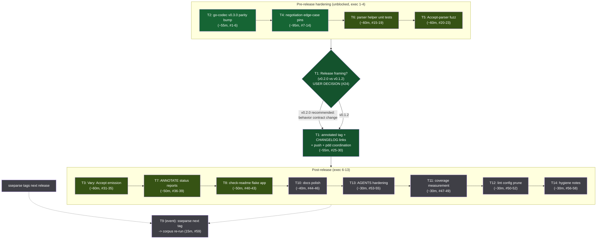

# Pareto Plan — 2026-09-30 00:50 — Release Hardening & Contract Pins

> **Closed 2026-09-30 (docs-health):** every task was executed — the closeout receipt lives in [docs/status/2026-09-30_11-29_release-v0.2.0-and-full-todo-closeout.md](../../status/archived/2026-09-30_11-29_release-v0.2.0-and-full-todo-closeout.md) §a. T-rows carry per-task verdicts with hashes; Level-2 subtasks carry `done (T<n>)` verdicts pointing at their parent task. Archived per docs-health classification — T9 remains a standing event row in TODO_LIST.md.

**Scope:** every open TODO_LIST row (16) plus the routed-out fleet pointers from
the 2026-09-30 status report §f. Sources: `TODO_LIST.md` (harvested
2026-09-30), `docs/status/2026-09-30_00-43_*` §f, `FEATURES.md`, `ROADMAP.md`.
Plan is a snapshot; `TODO_LIST.md` stays the living source (new items were
already harvested back into it this session).

**Ground truth at planning time:** all gates green (build / vet / race suite /
golangci-lint 0 issues / dprint / `nix build` / `nix run .#test`); origin at
`06b3071`, master ahead 4; three behavior changes (SSE spec fixes +
negotiation contract) sit untagged — plain `go get` consumers still resolve
v0.1.1 without them.

**Customer = consumers of this library** (project-discovery-daemon today; any
future `go get` consumer). Value = correctness of shipped behavior,
releasability, and trust that released contracts are pinned by tests.

## Pareto breakdown

### The 1% that delivers 51% — the release itself

One decision (v0.1.2 vs v0.2.0 framing) + ~30–60 min of mechanics (tag with a
narrative annotation, CHANGELOG compare links, push, pdd floor-bump + rev-pin
coordination). Everything valuable from the last sessions — SSE spec fixes,
the negotiation contract, the docs fleet — reaches customers only through this
act. It is 🔵 BLOCKED on the framing decision; 95% of the remaining plan
proceeds without it.

### The 4% that delivers 64% — make the release safe

Two tasks: **go-codec v0.3.0 parity bump** (restores the documented pin
policy; one vendorHash repair) and **negotiation edge-case pins** (wildcard,
duplicate-q, empty-q, never-refused property, golden matrix). The pins convert
the v0.2.0 contract from doc-comment-prose into test-enforced law — the exact
class of silent drift this session's audit fixed gets structurally prevented.

### The 20% that delivers 80% — close known correctness gaps + harden

Add: **Vary: Accept emission** (the one known shipped-behavior gap real HTTP
consumers can hit), **Accept-parser fuzzing** (hand-rolled parser + fuzz
precedent), **direct unit tests for the parser helpers**, **ANNOTATE the two
stale status reports** (knowledge closure), **`nix run .#check-readme`**
(turns the `caf1f0c` broken-README incident class into a build failure).

### The other 20% to reach 100%

Docs polish (Accept\* boundary, godoc example), AGENTS.md hardening
(atomic-edit-under-daemon gotcha, `nix flake check` in the sweep), coverage
measurement vs the 80% CI gate, lint-config prune, LSP/dependabot hygiene
notes, the event-driven sseparse corpus re-run, and the routed-out fleet
pointers (see end of file).

## Level 1 — comprehensive plan (30–100 min tasks, ALL TODOs)

Sorted by importance/impact/customer-value; `Exec` = recommended execution
order (unblocked pre-release hardening first). R4 (descriptive commit) is
absorbed into T1's tag annotation + this session's commits.

| ID                                                                                                         | Task (TODO rows)                                                                                                 | Pareto   | Exec   | Impact   | Effort   | Value delivered                                                                                       |
| ---------------------------------------------------------------------------------------------------------- | ---------------------------------------------------------------------------------------------------------------- | -------- | ------ | -------- | -------- | ----------------------------------------------------------------------------------------------------- |
| ~~T1~~ done — v0.2.0 (tag 3c66d39, commit c0aaf4c); pdd floor v0.2.0 + rev-pin at the tag commit (a92d625) | ~~Release: framing decision → annotated tag → CHANGELOG links → push → pdd floor-bump/rev-pin (R1, R4)~~         | ~~1%~~   | ~~5~~  | ~~High~~ | ~~~60m~~ | ~~Ships every accumulated fix/contract to all consumers; restores honest history via tag annotation~~ |
| ~~T2~~ done — go-codec v0.3.0 in go.mod (dependabot close-and-adopt; verified 2026-09-30)                  | ~~go-codec v0.2.0 → v0.3.0 + `buildflow -s nix-hash-fix --fix` + full gate (R2)~~                                | ~~4%~~   | ~~1~~  | ~~High~~ | ~~~55m~~ | ~~Pin parity with pdd per AGENTS.md policy; release carries aligned deps~~                            |
| ~~T3~~ done — 93f839c (Vary: Accept from WriteEncoded; FEATURES flipped)                                   | ~~`Vary: Accept` emission from `WriteEncoded` + tests + FEATURES flip (R3)~~                                     | ~~20%~~  | ~~6~~  | ~~High~~ | ~~~60m~~ | ~~Closes the only known shipped-behavior correctness gap (HTTP caching under dual encodings)~~        |
| ~~T4~~ done — e0ee7b0 (golden matrix + refusal property + Q= case-insensitivity fix)                       | ~~Negotiation edge-case pins: wildcard, duplicate-q, empty/`=`-less q, `Q=`, never-refused, golden matrix (R5)~~ | ~~4%~~   | ~~2~~  | ~~High~~ | ~~~95m~~ | ~~Contract becomes test-enforced; regressions reviewable in one table~~                               |
| ~~T5~~ done — fc818e5 (5m / 22.2M execs, 0 failures; seed-only corpus)                                     | ~~Accept-parser fuzz target + seeds + invariants + 5-min soak (R6)~~                                             | ~~20%~~  | ~~4~~  | ~~High~~ | ~~~60m~~ | ~~Panic/edge hardening of a hand-rolled parser on an untrusted header~~                               |
| ~~T6~~ done — b9c98eb (helper unit tables)                                                                 | ~~Unit tests for `bareMediaType`/`qualityParam`/`matchesEncoding` (R7)~~                                         | ~~20%~~  | ~~3~~  | ~~Med~~  | ~~~60m~~ | ~~Direct coverage of helpers currently tested only transitively~~                                     |
| ~~T7~~ done — 85c82ef (both 09-29 reports annotated; no archive — open cross-repo rows remain)             | ~~ANNOTATE both 2026-09-29 status reports inline + archive decision (R8)~~                                       | ~~20%~~  | ~~7~~  | ~~Med~~  | ~~~50m~~ | ~~Future sessions stop re-reading resolved work as open; docs-health completeness gate satisfied~~    |
| ~~T8~~ done — 9975100 (flake app, negative-tested)                                                         | ~~`nix run .#check-readme` flake app: compile README snippet in CI-reachable way (R9)~~                          | ~~20%~~  | ~~8~~  | ~~Med~~  | ~~~50m~~ | ~~Broken-example incident class (`caf1f0c`) becomes a standing build gate~~                           |
| ~~T9~~ standing — event-driven (sseparse still v0.1.0; TODO_LIST row)                                      | ~~sseparse corpus conformance re-run on next sseparse tag (R10) — **event-driven, standing**~~                   | ~~tail~~ | ~~E~~  | ~~Med~~  | ~~15m~~  | ~~Keeps the framing parser pinned to the WPT/Chromium oracle~~                                        |
| ~~T10~~ done — 8b62fe3 (boundary doc comment + ExampleResolveResponseCodec + doc.go)                       | ~~Docs polish: Accept-Charset/Encoding boundary + godoc example + doc.go alignment (R11, R12)~~                  | ~~tail~~ | ~~9~~  | ~~Low~~  | ~~~40m~~ | ~~Contract boundaries explicit; runnable example for godoc users~~                                    |
| ~~T11~~ done — 742bf3a (86.1% measured; CI 80% floor kept)                                                 | ~~Measure real coverage vs CI 80% gate; decide floor policy (R13)~~                                              | ~~tail~~ | ~~10~~ | ~~Low~~  | ~~~30m~~ | ~~Gates stop being information-free (go-sse fleet lesson)~~                                           |
| ~~T12~~ done — 4e11590 (3 dead allowlist entries pruned; lint 0)                                           | ~~Prune dead pdd entries from `.golangci.yml` ireturn allowlist + AGENTS wording (R14)~~                         | ~~tail~~ | ~~11~~ | ~~Low~~  | ~~~30m~~ | ~~Config honesty; mirror claim stays true~~                                                           |
| ~~T13~~ done — 33f44dd (atomic-edit gotcha + nix flake check in the sweep)                                 | ~~AGENTS.md: atomic-edit-under-daemon gotcha + `nix flake check` in sweep (R15)~~                                | ~~tail~~ | ~~12~~ | ~~Low~~  | ~~~30m~~ | ~~Prevents repeat of the `caf1f0c` docs-layer incident class~~                                        |
| ~~T14~~ done — 33f44dd (LSP triage note + dependabot policy + dprint pins)                                 | ~~Hygiene: LSP-cache triage note + dependabot-vendorHash policy (R16)~~                                          | ~~tail~~ | ~~13~~ | ~~Low~~  | ~~~30m~~ | ~~Session noise and dep-PR handling decided once, not per incident~~                                  |

**Totals:** ~11.5 h scheduled + 15 min event-driven. 14 timed tasks (all
30–100 min), 1 standing event task.

## Level 2 — detailed breakdown (≤12 min per subtask, ALL TODOs)

Sorted by execution order; subtasks within a task in dependency order.
`✓-gate` = run `golangci-lint fmt` + `run` + `go test ./... -race -count=1`
(and `nix build` when deps/summary change).

| #                     | Subtask                                                                                                     | Task    | Est     |
| --------------------- | ----------------------------------------------------------------------------------------------------------- | ------- | ------- |
| ~~1~~ done (~~T2~~)   | ~~Check go-codec v0.3.0 changelog/diff for breaking changes (its repo, read-only)~~                         | ~~T2~~  | ~~12m~~ |
| ~~2~~ done (~~T2~~)   | ~~`go get github.com/larsartmann/go-codec@v0.3.0 && go mod tidy` (in `nix develop`)~~                       | ~~T2~~  | ~~6m~~  |
| ~~3~~ done (~~T2~~)   | ~~Build + vet + race suite on bumped tree~~                                                                 | ~~T2~~  | ~~12m~~ |
| ~~4~~ done (~~T2~~)   | ~~`buildflow -s nix-hash-fix --fix` — repair own vendorHash, never hand-paste~~                             | ~~T2~~  | ~~12m~~ |
| ~~5~~ done (~~T2~~)   | ~~`nix build .#default && nix run .#test` on bumped tree~~                                                  | ~~T2~~  | ~~12m~~ |
| ~~6~~ done (~~T2~~)   | ~~AGENTS.md dep line update + CHANGELOG `Unreleased → Changed` bump note + close R2 row~~                   | ~~T2~~  | ~~12m~~ |
| ~~7~~ done (~~T4~~)   | ~~`application/*` wildcard echo test (pin no-preference behavior)~~                                         | ~~T4~~  | ~~12m~~ |
| ~~8~~ done (~~T4~~)   | ~~Duplicate-q precedence test: `application/json;q=0.5, application/json;q=0.9` (pin max-wins)~~            | ~~T4~~  | ~~12m~~ |
| ~~9~~ done (~~T4~~)   | ~~Empty `q=` and bare `;q` param tests (both fall back to 1)~~                                              | ~~T4~~  | ~~12m~~ |
| ~~10~~ done (~~T4~~)  | ~~`Q=` uppercase param-name: verify RFC 9110 case-insensitivity, fix if wrong, pin with test~~              | ~~T4~~  | ~~12m~~ |
| ~~11~~ done (~~T4~~)  | ~~Never-serve-refused property test over the q=0 × request-codec matrix~~                                   | ~~T4~~  | ~~12m~~ |
| ~~12~~ done (~~T4~~)  | ~~Golden behavior-matrix table pt 1: mentions/wildcards/q-rankings~~                                        | ~~T4~~  | ~~12m~~ |
| ~~13~~ done (~~T4~~)  | ~~Golden behavior-matrix table pt 2: refusals, both-refused, unparseable q, browser header~~                | ~~T4~~  | ~~12m~~ |
| ~~14~~ done (~~T4~~)  | ~~✓-gate + close R5 row + CHANGELOG test note if a fix falls out~~                                          | ~~T4~~  | ~~12m~~ |
| ~~15~~ done (~~T6~~)  | ~~`bareMediaType` table test: params, case, whitespace~~                                                    | ~~T6~~  | ~~12m~~ |
| ~~16~~ done (~~T6~~)  | ~~`qualityParam` table test: spaces, `Q=`, clamping, unparseable~~                                          | ~~T6~~  | ~~12m~~ |
| ~~17~~ done (~~T6~~)  | ~~`matchesEncoding` table test: suffixes, near-misses (`+cbor` vs `cbor-seq`)~~                             | ~~T6~~  | ~~12m~~ |
| ~~18~~ done (~~T6~~)  | ~~`acceptQuality` mentioned/quality logic incl. duplicate max~~                                             | ~~T6~~  | ~~12m~~ |
| ~~19~~ done (~~T6~~)  | ~~✓-gate + close R7 row~~                                                                                   | ~~T6~~  | ~~12m~~ |
| ~~20~~ done (~~T5~~)  | ~~`FuzzResolveResponseCodec`: seeds (browser headers, `*/*`, junk q, 100-entry lists)~~                     | ~~T5~~  | ~~12m~~ |
| ~~21~~ done (~~T5~~)  | ~~Fuzz invariants: no panic; result ∈ {JSON, CBOR, reqCodec}; never a q=0-refused encoding~~                | ~~T5~~  | ~~12m~~ |
| ~~22~~ done (~~T5~~)  | ~~Local 5-min soak (`go test -fuzz -fuzztime=5m`)~~                                                         | ~~T5~~  | ~~12m~~ |
| ~~23~~ done (~~T5~~)  | ~~Seed-corpus handling decision (commit corpus or seed-only) + ✓-gate + close R6 row~~                      | ~~T5~~  | ~~12m~~ |
| ~~24~~ done (~~T1~~)  | ~~Ask/confirm release framing: v0.2.0 (behavior-contract) vs v0.1.2 (bugfix) — **user decision**~~          | ~~T1~~  | ~~2m~~  |
| ~~25~~ done (~~T1~~)  | ~~Draft tag annotation narrative (negotiation contract + SSE spec fixes + go-codec bump + why)~~            | ~~T1~~  | ~~12m~~ |
| ~~26~~ done (~~T1~~)  | ~~CHANGELOG: fold go-codec note into release section; add new version + compare links~~                     | ~~T1~~  | ~~12m~~ |
| ~~27~~ done (~~T1~~)  | ~~Full pre-tag gate sweep (build/vet/race/lint/nix build/nix run .#test)~~                                  | ~~T1~~  | ~~12m~~ |
| ~~28~~ done (~~T1~~)  | ~~`git tag -a vX.Y.Z` + push master + tag (explicit user go-ahead per rule)~~                               | ~~T1~~  | ~~5m~~  |
| ~~29~~ done (~~T1~~)  | ~~pdd (cross-repo): go.mod floor-bump + nix rev-pin re-derivation + build/test there~~                      | ~~T1~~  | ~~12m~~ |
| ~~30~~ done (~~T1~~)  | ~~Close R1 + R4 rows; verify module proxy resolves new tag; note pkg.go.dev lag~~                           | ~~T1~~  | ~~12m~~ |
| ~~31~~ done (~~T3~~)  | ~~Design `Vary: Accept`: emit unconditionally in `WriteEncoded` vs only when Accept influenced encoding~~   | ~~T3~~  | ~~12m~~ |
| ~~32~~ done (~~T3~~)  | ~~Implement emission + doc-comment contract~~                                                               | ~~T3~~  | ~~12m~~ |
| ~~33~~ done (~~T3~~)  | ~~Tests: no-Accept (no Vary or correct Vary per design), Accept-driven, refused-encoding substitution~~     | ~~T3~~  | ~~12m~~ |
| ~~34~~ done (~~T3~~)  | ~~Docs: README row, FEATURES PLANNED → FULLY_FUNCTIONAL flip, CHANGELOG entry, close R3 row~~               | ~~T3~~  | ~~12m~~ |
| ~~35~~ done (~~T3~~)  | ~~✓-gate~~                                                                                                  | ~~T3~~  | ~~12m~~ |
| ~~36~~ done (~~T7~~)  | ~~Emit keys via `--emit-keys` + `--dry-run` first spec against 09-01 report (never hand-type keys)~~        | ~~T7~~  | ~~12m~~ |
| ~~37~~ done (~~T7~~)  | ~~Apply inline strikes to 09-01 report; run row-completeness check~~                                        | ~~T7~~  | ~~12m~~ |
| ~~38~~ done (~~T7~~)  | ~~Same for 11-35 report; verify with check scripts + `grep -rLn '~~'` gate~~                                | ~~T7~~  | ~~12m~~ |
| ~~39~~ done (~~T7~~)  | ~~ARCHIVE classification; `git mv` fully-resolved reports to `docs/status/archived/` if applicable~~        | ~~T7~~  | ~~12m~~ |
| ~~40~~ done (~~T8~~)  | ~~Extract first ```go fence → temp `main.go` script (awk; the exact harness from 2026-09-30 session)~~      | ~~T8~~  | ~~12m~~ |
| ~~41~~ done (~~T8~~)  | ~~Wrap as `mkGoApp "check-readme"` flake app compiling the snippet to `/dev/null`~~                         | ~~T8~~  | ~~12m~~ |
| ~~42~~ done (~~T8~~)  | ~~Negative test: break snippet on purpose, app must fail; restore; `nix build`~~                            | ~~T8~~  | ~~12m~~ |
| ~~43~~ done (~~T8~~)  | ~~AGENTS.md Essential Commands + close R9 row~~                                                             | ~~T8~~  | ~~12m~~ |
| ~~44~~ done (~~T10~~) | ~~Accept-Charset/Accept-Encoding out-of-scope boundary in negotiation.go doc comments + close R11~~         | ~~T10~~ | ~~12m~~ |
| ~~45~~ done (~~T10~~) | ~~`negotiation_example_test.go` godoc example (request codec → handler → WriteEncoded) + close R12~~        | ~~T10~~ | ~~12m~~ |
| ~~46~~ done (~~T10~~) | ~~doc.go negotiation sentence alignment with README contract summary + ✓-gate + dprint~~                    | ~~T10~~ | ~~12m~~ |
| ~~47~~ done (~~T11~~) | ~~`go test -coverprofile` + `go tool cover -func`; record per-area numbers~~                                | ~~T11~~ | ~~12m~~ |
| ~~48~~ done (~~T11~~) | ~~Compare vs CI 80% gate; decide floor-raise policy (no blind raise)~~                                      | ~~T11~~ | ~~12m~~ |
| ~~49~~ done (~~T11~~) | ~~Record numbers in FEATURES verification basis + close R13 row~~                                           | ~~T11~~ | ~~6m~~  |
| ~~50~~ done (~~T12~~) | ~~Diff ireturn allowlist vs actual usage (`rg` for the pdd types)~~                                         | ~~T12~~ | ~~12m~~ |
| ~~51~~ done (~~T12~~) | ~~Prune dead entries; lint must stay 0 issues~~                                                             | ~~T12~~ | ~~12m~~ |
| ~~52~~ done (~~T12~~) | ~~Update AGENTS.md mirror wording ("mirrored, locally pruned") + close R14 row~~                            | ~~T12~~ | ~~6m~~  |
| ~~53~~ done (~~T13~~) | ~~AGENTS.md gotcha: atomic edits under the auto-daemon (single self-consistent edits; gate between steps)~~ | ~~T13~~ | ~~12m~~ |
| ~~54~~ done (~~T13~~) | ~~AGENTS.md: add `nix flake check` to Essential Commands sweep~~                                            | ~~T13~~ | ~~12m~~ |
| ~~55~~ done (~~T13~~) | ~~dprint-then-edit re-read rule note + close R15 row~~                                                      | ~~T13~~ | ~~6m~~  |
| ~~56~~ done (~~T14~~) | ~~LSP-cache triage note: `lsp_restart` when phantom errors contradict CLI gates~~                           | ~~T14~~ | ~~12m~~ |
| ~~57~~ done (~~T14~~) | ~~Dependabot-vendorHash policy: pre-agree close-and-adopt vs maintainer-fix; document in AGENTS.md~~        | ~~T14~~ | ~~12m~~ |
| ~~58~~ done (~~T14~~) | ~~dprint plugin pin freshness check + close R16 row~~                                                       | ~~T14~~ | ~~6m~~  |
| ~~59~~ done (~~T9~~)  | ~~(Event) sseparse next tag: bump dep, re-run conformance, fix divergences, nix-hash-fix, CHANGELOG — R10~~ | ~~T9~~  | ~~15m~~ |

**Totals:** 59 subtasks; ~9.5 h estimated; every subtask ≤ 12 min; 1
event-driven. Critical path (decision mechanics only): 24 → 25 → 26 → 27 → 28.

## Execution graph



## Routed out (not this repo's tasks — fleet pointers, status §f 31–50)

pdd verification/re-pin (lives in pdd, coordinated by T1 #29), go-codec
changelog check (read-only, part of T2 #1), go-cqrs-lite adoption decision and
the go-codec extraction trigger (ROADMAP theme 3), consumer-chain diagram
(ROADMAP), crush-config lessons (own repo), go-sse/go-datastar/buildflow
queues (their repos).

## Verschlimmbesserung guardrails

- No behavior change ships without its pin test (T4 before T1 tag).
- Every dep change goes through `buildflow -s nix-hash-fix --fix`; never
  hand-paste hashes; `nix build` is part of every dep-touching gate.
- Historical reports are annotated inline (never rewritten); archive only via
  docs-health classification.
- No lint-floor or coverage-floor raise without measured numbers behind it.
- Tag only after the full gate sweep passes; push only with explicit user
  go-ahead (given for this session's plan commits; the tag push itself is
  subtask #28 under the same rule).
