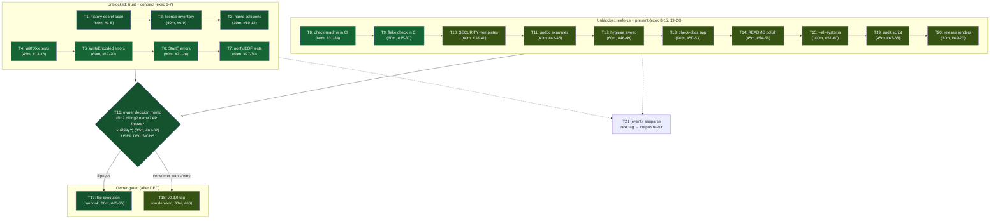

# Pareto Plan — 2026-10-01 02:23 — Pre-Flip Trust Scans & Contract Hardening

> **Live remainder:** executed end to end on 2026-10-01 — the closeout receipt is `docs/status/archived/2026-10-01_03-52_pareto-plan-execution-trust-tests-ci.md`. Every T-row and subtask carries a verdict; surviving work is tracked in `TODO_LIST.md`/`ROADMAP.md`. Archived 2026-11-27.

**Scope:** every open TODO_LIST row (29) plus the actionable session-grounded
follow-ups from `docs/status/2026-10-01_02-15_docs-health-annotate-archive-harvest-pass.md`
§f30-50. Cross-repo items (crush-config lessons, docs-health skill assets,
pdd-side work) are routed out, not planned here.

**Ground truth at planning time:** all gates green (build / vet / race suite /
golangci-lint 0 issues / `nix build` / `nix flake check` / check-readme /
dprint / check-rows with two documented by-design exits); tree clean at
`152fbb8`; coverage 86.1% (CI gate 80%); v0.2.0 tagged, pdd floor-bumped and
rev-pinned at `c0aaf4c`; 5 🔵 owner gates block the go-public flip.

**Customer:** consumers of this library (project-discovery-daemon today; any
`go get` user after the flip) and the owner whose stated next milestone is the
public flip. Value = contract robustness, enforced gates, and a flip that is
one decision away instead of three unknowns away.

## Pareto breakdown

### The 1% that delivers 51% — the pre-flip trust package

Three cheap scans (git-history secrets, dependency licenses, module-name
collisions, ~2.5h total) plus the owner-decision memo that packages their
results. Their absence is the ONLY technical thing between this repo and its
loudest standing goal (the flip, per the 10-33 report). Everything else on
the board is worth less than this gate — and none of it is blocked.

### The 4% that delivers 64% — close the test-coverage gaps

The only CODE work on the board: 4 rows (~4.5h) covering the seven 0%
`WithXxx` setters, `WriteEncoded`'s encode-error path, `Start()`'s
startup-error paths, `notifyStopping`, and `lineAtEOF`. These are the
contract's untested edges — a red test here is a found bug, and 86.1% grows
real margin over the 80% CI floor. Tests only assert existing behavior;
anything red gets fix-forwarded with a CHANGELOG entry (see guardrails).

### The 20% that delivers 80% — enforce the gates, show the flag

The trust package is worthless if the repo's own gates stay local-only:
wire check-readme + `nix flake check` into ci.yml (billing still gates
whether CI runs, but the config must be ready), audit ci.yml for private
assumptions, add SECURITY.md + issue templates + repo description/topics,
and the check-docs app that chains dprint/check-rows/strike-presence so docs
health stops being a per-session ritual.

### The other 20% to reach 100%

Hygiene tail (CONTRIBUTING nix-first rewrite, `90f86db` provenance,
golangci mirror-drift diff, `flake check --all-systems`, README external
polish + non-goals pointer, godoc examples), the pre-publish audit script
that generalizes the scans, post-flip runbook (gated), v0.3.0 prep
(demand-gated), and the two release-render checks.

## Level 1 — comprehensive plan (30–100 min tasks, ALL TODOs)

`Exec` = recommended execution order. Decision-gated tasks run only after the
owner answers the memo. Every task ends in the ✓-gate: `golangci-lint fmt` +
`run` + `go test ./... -race -count=1` (+ `nix build` when flake.nix changes).

| ID                                         | Task (TODO rows)                                                                                                   | Pareto    | Exec   | Impact                | Effort   | Value delivered                                                                               |
| ------------------------------------------ | ------------------------------------------------------------------------------------------------------------------ | --------- | ------ | --------------------- | -------- | --------------------------------------------------------------------------------------------- |
| ~~T1~~ done (docs-health pass 2026-11-27)  | ~~Full git-history secret scan (go-public 1)~~                                                                     | ~~1%~~    | ~~1~~  | ~~blocking for flip~~ | ~~60m~~  | ~~The flip's scariest unknown becomes a checked box or a finding list~~                       |
| ~~T2~~ done (docs-health pass 2026-11-27)  | ~~Dependency license inventory from go.sum (go-public 2)~~                                                         | ~~1%~~    | ~~2~~  | ~~legal hygiene~~     | ~~60m~~  | ~~MIT repo knows exactly what it ships; NOTICE decision grounded~~                            |
| ~~T3~~ done (docs-health pass 2026-11-27)  | ~~Module-name collision check: sevlyar + pkg.go.dev (go-public 3)~~                                                | ~~1%~~    | ~~3~~  | ~~naming input~~      | ~~30m~~  | ~~Name decision gets data instead of hedges~~                                                 |
| ~~T4~~ done (docs-health pass 2026-11-27)  | ~~Unit-test the 7 uncovered `WithXxx` setters + `SocketPath` (tests 1)~~                                           | ~~4%~~    | ~~4~~  | ~~Med~~               | ~~45m~~  | ~~The cheapest coverage on the board; option behavior becomes pinned~~                        |
| ~~T5~~ done (docs-health pass 2026-11-27)  | ~~Cover `WriteEncoded` encode-error + non-BufferEncoder paths (tests 2)~~                                          | ~~4%~~    | ~~5~~  | ~~Med~~               | ~~60m~~  | ~~Error paths of the hot write helper get pinned; a red here is a found bug~~                 |
| ~~T6~~ done (docs-health pass 2026-11-27)  | ~~Cover `Start()` startup-error paths (tests 3)~~                                                                  | ~~4%~~    | ~~6~~  | ~~Med~~               | ~~90m~~  | ~~The lifecycle entry point's failure modes get regression-pinned~~                           |
| ~~T7~~ done (docs-health pass 2026-11-27)  | ~~Cover `notifyStopping` + `lineAtEOF` (tests 4)~~                                                                 | ~~4%~~    | ~~7~~  | ~~Med~~               | ~~60m~~  | ~~Last two sub-70% functions covered; coverage floor raise becomes discussable with numbers~~ |
| ~~T8~~ done (docs-health pass 2026-11-27)  | ~~check-readme into ci.yml (CI row, part 1)~~                                                                      | ~~20%~~   | ~~8~~  | ~~High~~              | ~~60m~~  | ~~The `caf1f0c` incident class becomes CI-enforced, not local-only~~                          |
| ~~T9~~ done (docs-health pass 2026-11-27)  | ~~`nix flake check` in ci.yml + private-assumption audit (CI row, part 2)~~                                        | ~~20%~~   | ~~9~~  | ~~High~~              | ~~60m~~  | ~~The only gate that catches vendorHash staleness stops being local-only~~                    |
| ~~T10~~ done (docs-health pass 2026-11-27) | ~~SECURITY.md + issue templates + repo description/topics (go-public 5-6)~~                                        | ~~20%~~   | ~~10~~ | ~~Med~~               | ~~60m~~  | ~~Repo looks maintained to a first-time visitor; security contact exists pre-flip~~           |
| ~~T11~~ done (docs-health pass 2026-11-27) | ~~Godoc examples: `ExampleParseSSEData` + socket example (hygiene 4)~~                                             | ~~20%~~   | ~~11~~ | ~~Low~~               | ~~60m~~  | ~~The godoc-example convention extends to the two remaining flagship surfaces~~               |
| ~~T12~~ done (docs-health pass 2026-11-27) | ~~Hygiene sweep: `90f86db` provenance + CONTRIBUTING nix-first + golangci mirror diff (hygiene 1-3)~~              | ~~20%~~   | ~~12~~ | ~~Med~~               | ~~60m~~  | ~~Three XS/S curiosities closed in one sitting; docs stop contradicting each other~~          |
| ~~T13~~ done (docs-health pass 2026-11-27) | ~~check-docs flake app: dprint --check + check-rows + strike-presence + FEATURES-count gate (hygiene 6)~~          | ~~20%~~   | ~~13~~ | ~~Med~~               | ~~90m~~  | ~~Doc health becomes one command; the counts-rotted-twice class dies~~                        |
| ~~T14~~ done (docs-health pass 2026-11-27) | ~~README external polish + Non-goals pointer (go-public 4 + hygiene 7)~~                                           | ~~20%~~   | ~~14~~ | ~~Med~~               | ~~45m~~  | ~~First impression ready for the flip; mechanism-not-policy visible on the sales page~~       |
| ~~T15~~ done (docs-health pass 2026-11-27) | ~~`nix flake check --all-systems` pass (hygiene 5)~~                                                               | ~~tail~~  | ~~15~~ | ~~Low~~               | ~~100m~~ | ~~darwin/aarch64 omission understood or fixed; the warning stops being ignored~~              |
| ~~T16~~ done (docs-health pass 2026-11-27) | ~~Owner decision memo: API freeze, name, docs visibility, billing, flip — data + recommendation each (5 🔵 rows)~~ | ~~1%~~    | ~~16~~ | ~~blocking~~          | ~~30m~~  | ~~Five owner decisions become answerable in one sitting; unblocks T17/T18~~                   |
| ~~T17~~ done (docs-health pass 2026-11-27) | ~~Post-flip runbook: AGENTS GOPRIVATE cleanup + pdd plain-input re-pin (go-public 8-9, 🔵 gated)~~                 | ~~20%~~   | ~~17~~ | ~~High (post-flip)~~  | ~~60m~~  | ~~The flip's mechanical tail pre-written; execution becomes 30min, not an afternoon~~         |
| ~~T18~~ done (docs-health pass 2026-11-27) | ~~v0.3.0 prep: tag annotation draft + compare links (release 1, 🔵 demand-gated)~~                                 | ~~tail~~  | ~~18~~ | ~~High (on demand)~~  | ~~30m~~  | ~~When a consumer wants Vary, shipping is one command~~                                       |
| ~~T19~~ done (docs-health pass 2026-11-27) | ~~Pre-publish audit script generalizing T1-T3 (go-public 7)~~                                                      | ~~20%~~   | ~~19~~ | ~~Med~~               | ~~45m~~  | ~~The next repo flip (fleet-wide) is a command, not an improvisation~~                        |
| ~~T20~~ done (docs-health pass 2026-11-27) | ~~Release-render checks: GH release page + pkg.go.dev (release 2-3)~~                                              | ~~tail~~  | ~~20~~ | ~~Low~~               | ~~30m~~  | ~~v0.2.0's storefront verified; publishing loop closed~~                                      |
| ~~T21~~ done (docs-health pass 2026-11-27) | ~~STANDING (event): sseparse corpus re-run on next tag~~                                                           | ~~event~~ | ~~E~~  | ~~Med~~               | ~~15m~~  | ~~Framing parser stays pinned to the WPT/Chromium oracle~~                                    |

**Totals:** ~19h scheduled + 15min event-driven. 20 timed tasks, 1 standing.
Routed out (other repos' queues, not planned here): docs-health skill assets
(per-cell table mode, check-rows open-row hatch), crush-config lessons.md
(dprint-vs-strikes lesson), pdd Vary adoption, buildflow UX report,
prose-strike backfill.

## Level 2 — detailed breakdown (≤12 min per subtask, ALL TODOs)

Sorted by execution order. `✓-gate` = `golangci-lint fmt` + `run` +
`go test ./... -race -count=1` (+ `nix build` when flake.nix changes).

| #                                         | Subtask                                                                                                                    | Task    | Est     |
| ----------------------------------------- | -------------------------------------------------------------------------------------------------------------------------- | ------- | ------- |
| ~~1~~ done (docs-health pass 2026-11-27)  | ~~Enumerate scan surface: `git rev-list --all --count`, deleted-file list (`--diff-filter=D --name-only`), artifact dirs~~ | ~~T1~~  | ~~12m~~ |
| ~~2~~ done (docs-health pass 2026-11-27)  | ~~Blob grep pass 1: secret patterns (PEM/key/token/password/env) over all blobs~~                                          | ~~T1~~  | ~~12m~~ |
| ~~3~~ done (docs-health pass 2026-11-27)  | ~~Blob grep pass 2: high-entropy strings, internal hosts/paths, `.netrc`/credential-shaped content~~                       | ~~T1~~  | ~~12m~~ |
| ~~4~~ done (docs-health pass 2026-11-27)  | ~~Manually inspect hits; classify real vs false positive; record verdicts~~                                                | ~~T1~~  | ~~12m~~ |
| ~~5~~ done (docs-health pass 2026-11-27)  | ~~Write findings into TODO evidence; flip-blocker status becomes green/clear~~                                             | ~~T1~~  | ~~12m~~ |
| ~~6~~ done (docs-health pass 2026-11-27)  | ~~Extract license metadata for direct deps (`go list -m` + proxy info)~~                                                   | ~~T2~~  | ~~12m~~ |
| ~~7~~ done (docs-health pass 2026-11-27)  | ~~License table for indirect deps (prometheus stack, cbor, x/sys, protobuf)~~                                              | ~~T2~~  | ~~12m~~ |
| ~~8~~ done (docs-health pass 2026-11-27)  | ~~NOTICE-file decision: does MIT + Apache-2.0/BSD require attribution files? Draft if yes~~                                | ~~T2~~  | ~~12m~~ |
| ~~9~~ done (docs-health pass 2026-11-27)  | ~~Record inventory in TODO evidence + close row~~                                                                          | ~~T2~~  | ~~12m~~ |
| ~~10~~ done (docs-health pass 2026-11-27) | ~~`gh repo view sevlyar/go-daemon` — verify claims, record license/activity/module path~~                                  | ~~T3~~  | ~~12m~~ |
| ~~11~~ done (docs-health pass 2026-11-27) | ~~pkg.go.dev search `go-daemon` — inventory every conflicting module~~                                                     | ~~T3~~  | ~~12m~~ |
| ~~12~~ done (docs-health pass 2026-11-27) | ~~Collision verdict into TODO evidence; naming-decision input ready~~                                                      | ~~T3~~  | ~~12m~~ |
| ~~13~~ done (docs-health pass 2026-11-27) | ~~Read socket.go option setters + existing option-test patterns (`WithSocketMode`/`WithHealthPath` as templates)~~         | ~~T4~~  | ~~12m~~ |
| ~~14~~ done (docs-health pass 2026-11-27) | ~~Table test: 7 setters (DirMode, Logger, Version, ReadHeaderTimeout, IdleTimeout, ShutdownGracePeriod, ProbeTimeout)~~    | ~~T4~~  | ~~12m~~ |
| ~~15~~ done (docs-health pass 2026-11-27) | ~~Cover `SocketPath` getter (0%) in the same table~~                                                                       | ~~T4~~  | ~~12m~~ |
| ~~16~~ done (docs-health pass 2026-11-27) | ~~✓-gate + coverage delta + close row~~                                                                                    | ~~T4~~  | ~~12m~~ |
| ~~17~~ done (docs-health pass 2026-11-27) | ~~Read write.go `WriteEncoded`; design failing-codec injection (BufferEncoder stub returning error)~~                      | ~~T5~~  | ~~12m~~ |
| ~~18~~ done (docs-health pass 2026-11-27) | ~~Implement encode-error test (asserts no partial write, error propagated)~~                                               | ~~T5~~  | ~~12m~~ |
| ~~19~~ done (docs-health pass 2026-11-27) | ~~Cover the non-BufferEncoder fallback path~~                                                                              | ~~T5~~  | ~~12m~~ |
| ~~20~~ done (docs-health pass 2026-11-27) | ~~✓-gate + write.go coverage delta + close row~~                                                                           | ~~T5~~  | ~~12m~~ |
| ~~21~~ done (docs-health pass 2026-11-27) | ~~Map `Start()`'s uncovered branches (cover -func + socket.go:195-315 read)~~                                              | ~~T6~~  | ~~12m~~ |
| ~~22~~ done (docs-health pass 2026-11-27) | ~~Design failure injections: socket path occupied / unwritable dir / invalid path~~                                        | ~~T6~~  | ~~12m~~ |
| ~~23~~ done (docs-health pass 2026-11-27) | ~~Implement startup-error test 1 (occupied/dir socket path)~~                                                              | ~~T6~~  | ~~12m~~ |
| ~~24~~ done (docs-health pass 2026-11-27) | ~~Implement startup-error test 2 (permission-denied dir)~~                                                                 | ~~T6~~  | ~~12m~~ |
| ~~25~~ done (docs-health pass 2026-11-27) | ~~Implement Lifecycle `Startup`-hook error propagation test~~                                                              | ~~T6~~  | ~~12m~~ |
| ~~26~~ done (docs-health pass 2026-11-27) | ~~✓-gate + coverage delta + close row (fix-forward + CHANGELOG if any test finds a real bug)~~                             | ~~T6~~  | ~~12m~~ |
| ~~27~~ done (docs-health pass 2026-11-27) | ~~Read `notifyStopping` (socket.go:327); design `NOTIFY_SOCKET` set/unset via `t.Setenv`~~                                 | ~~T7~~  | ~~12m~~ |
| ~~28~~ done (docs-health pass 2026-11-27) | ~~Implement notifyStopping table test~~                                                                                    | ~~T7~~  | ~~12m~~ |
| ~~29~~ done (docs-health pass 2026-11-27) | ~~Read `lineAtEOF` (sse.go:196); implement EOF-boundary table cases~~                                                      | ~~T7~~  | ~~12m~~ |
| ~~30~~ done (docs-health pass 2026-11-27) | ~~✓-gate + coverage delta + close row~~                                                                                    | ~~T7~~  | ~~12m~~ |
| ~~31~~ done (docs-health pass 2026-11-27) | ~~Decide mechanism: nix-on-runner (pinned install action) vs go-native fence-extractor script~~                            | ~~T8~~  | ~~12m~~ |
| ~~32~~ done (docs-health pass 2026-11-27) | ~~If go-native: write scripts/check-readme.sh (awk fence extraction + temp module + `go build`)~~                          | ~~T8~~  | ~~12m~~ |
| ~~33~~ done (docs-health pass 2026-11-27) | ~~Negative-test the chosen mechanism (broken snippet → exit 1; restore → 0)~~                                              | ~~T8~~  | ~~12m~~ |
| ~~34~~ done (docs-health pass 2026-11-27) | ~~Wire into ci.yml; actionlint; commit~~                                                                                   | ~~T8~~  | ~~12m~~ |
| ~~35~~ done (docs-health pass 2026-11-27) | ~~Add pinned nix install step + `nix build .#default && nix flake check` step~~                                            | ~~T9~~  | ~~12m~~ |
| ~~36~~ done (docs-health pass 2026-11-27) | ~~Audit ci.yml for private-runner/secret assumptions; record verdict~~                                                     | ~~T9~~  | ~~12m~~ |
| ~~37~~ done (docs-health pass 2026-11-27) | ~~actionlint + commit + close CI row~~                                                                                     | ~~T9~~  | ~~12m~~ |
| ~~38~~ done (docs-health pass 2026-11-27) | ~~Draft SECURITY.md (supported versions, private reporting contact)~~                                                      | ~~T10~~ | ~~12m~~ |
| ~~39~~ done (docs-health pass 2026-11-27) | ~~Draft bug + feature issue templates (yaml forms)~~                                                                       | ~~T10~~ | ~~12m~~ |
| ~~40~~ done (docs-health pass 2026-11-27) | ~~Set repo description + topics via `gh repo edit`~~                                                                       | ~~T10~~ | ~~12m~~ |
| ~~41~~ done (docs-health pass 2026-11-27) | ~~Review + commit + close two go-public rows~~                                                                             | ~~T10~~ | ~~12m~~ |
| ~~42~~ done (docs-health pass 2026-11-27) | ~~Study negotiation_example_test.go convention (Output-verified examples)~~                                                | ~~T11~~ | ~~12m~~ |
| ~~43~~ done (docs-health pass 2026-11-27) | ~~Write `ExampleParseSSEData` with Output~~                                                                                | ~~T11~~ | ~~12m~~ |
| ~~44~~ done (docs-health pass 2026-11-27) | ~~Write socket/lifecycle godoc example~~                                                                                   | ~~T11~~ | ~~12m~~ |
| ~~45~~ done (docs-health pass 2026-11-27) | ~~✓-gate (examples run as tests) + close row~~                                                                             | ~~T11~~ | ~~12m~~ |
| ~~46~~ done (docs-health pass 2026-11-27) | ~~Investigate `90f86db` provenance (git show, reflog); record one-line answer~~                                            | ~~T12~~ | ~~12m~~ |
| ~~47~~ done (docs-health pass 2026-11-27) | ~~Rewrite CONTRIBUTING.md nix-first (devShell commands, doc gates, buildflow note)~~                                       | ~~T12~~ | ~~12m~~ |
| ~~48~~ done (docs-health pass 2026-11-27) | ~~`diff` .golangci.yml vs pdd's; record drift verdict; sync or prune deliberately~~                                        | ~~T12~~ | ~~12m~~ |
| ~~49~~ done (docs-health pass 2026-11-27) | ~~✓-gate + commit + close three hygiene rows~~                                                                             | ~~T12~~ | ~~12m~~ |
| ~~50~~ done (docs-health pass 2026-11-27) | ~~Write scripts/check-docs.sh: dprint --check + check-rows over docs/ + strike-presence grep~~                             | ~~T13~~ | ~~12m~~ |
| ~~51~~ done (docs-health pass 2026-11-27) | ~~Add FEATURES-count derivation (grep FULLY_FUNCTIONAL vs the Counts line) to the script~~                                 | ~~T13~~ | ~~12m~~ |
| ~~52~~ done (docs-health pass 2026-11-27) | ~~Wrap as flake app `check-docs`; ✓-gate + `nix build` (flake touched)~~                                                   | ~~T13~~ | ~~12m~~ |
| ~~53~~ done (docs-health pass 2026-11-27) | ~~Negative-test (break a strike → exit 1; restore → 0); AGENTS.md Essential Commands; close row~~                          | ~~T13~~ | ~~12m~~ |
| ~~54~~ done (docs-health pass 2026-11-27) | ~~Read README end-to-end as an external newcomer; note friction list~~                                                     | ~~T14~~ | ~~12m~~ |
| ~~55~~ done (docs-health pass 2026-11-27) | ~~Polish + add Non-goals pointer to ROADMAP~~                                                                              | ~~T14~~ | ~~12m~~ |
| ~~56~~ done (docs-health pass 2026-11-27) | ~~`nix run .#check-readme` + dprint + close two rows~~                                                                     | ~~T14~~ | ~~12m~~ |
| ~~57~~ done (docs-health pass 2026-11-27) | ~~Reproduce the `--all-systems` failure; capture the exact error~~                                                         | ~~T15~~ | ~~12m~~ |
| ~~58~~ done (docs-health pass 2026-11-27) | ~~Diagnose: which outputs lack darwin/aarch64 support (go-systemd is linux-only)~~                                         | ~~T15~~ | ~~12m~~ |
| ~~59~~ done (docs-health pass 2026-11-27) | ~~Fix: meta.platforms guards or per-system app filtering~~                                                                 | ~~T15~~ | ~~12m~~ |
| ~~60~~ done (docs-health pass 2026-11-27) | ~~Verify `--all-systems` green + ✓-gate + close row~~                                                                      | ~~T15~~ | ~~12m~~ |
| ~~61~~ done (docs-health pass 2026-11-27) | ~~Draft decision memo: API freeze + name (T3 data) + visibility (T1 scrub-cost data)~~                                     | ~~T16~~ | ~~12m~~ |
| ~~62~~ done (docs-health pass 2026-11-27) | ~~Add billing + flip recommendations; link TODO rows; present to owner~~                                                   | ~~T16~~ | ~~12m~~ |
| ~~63~~ done (docs-health pass 2026-11-27) | ~~Write post-flip AGENTS.md cleanup diff (GOPRIVATE/`mkPreparedSource` gotchas) — apply only after flip~~                  | ~~T17~~ | ~~12m~~ |
| ~~64~~ done (docs-health pass 2026-11-27) | ~~Write pdd de-GOPRIVATE + plain-input + vendorHash re-derive runbook steps — execute only after flip~~                    | ~~T17~~ | ~~12m~~ |
| ~~65~~ done (docs-health pass 2026-11-27) | ~~Write announcement/docs-site decision pointer; close runbook prep~~                                                      | ~~T17~~ | ~~12m~~ |
| ~~66~~ done (docs-health pass 2026-11-27) | ~~Draft v0.3.0 tag annotation + CHANGELOG compare-link diff — apply only on demand signal~~                                | ~~T18~~ | ~~12m~~ |
| ~~67~~ done (docs-health pass 2026-11-27) | ~~Generalize T1-T3 methods into scripts/pre-publish-audit.sh (history + licenses + private paths)~~                        | ~~T19~~ | ~~12m~~ |
| ~~68~~ done (docs-health pass 2026-11-27) | ~~Negative-test the script; wire into check-docs docs; close row~~                                                         | ~~T19~~ | ~~12m~~ |
| ~~69~~ done (docs-health pass 2026-11-27) | ~~`gh release view v0.2.0` — verify page rendering; close row~~                                                            | ~~T20~~ | ~~12m~~ |
| ~~70~~ done (docs-health pass 2026-11-27) | ~~Fetch pkg.go.dev rendering; verify + close row~~                                                                         | ~~T20~~ | ~~12m~~ |
| ~~71~~ done (docs-health pass 2026-11-27) | ~~(Event) sseparse next tag: bump test-only dep, re-run conformance, nix-hash-fix, CHANGELOG~~                             | ~~T21~~ | ~~15m~~ |

**Totals:** 71 subtasks; ~13.5h estimated; every subtask ≤ 12min; 1
event-driven. Critical path (flip): 1→2→3→61→62 → [owner decides] → 63-65.

## Execution graph

## Verschlimmbesserung guardrails

- Tests assert EXISTING behavior only. A red test means either a broken test
  or a found bug: analyze first; real bugs get fix-forwarded with a CHANGELOG
  entry — never test-tweaked into green.
- No dependency changes anywhere in this plan (vendorHash stays safe); any
  flake.nix touch runs `nix build` in its gate; hashes only via
  `buildflow -s nix-hash-fix --fix`, never hand-pasted.
- Historical reports stay annotated, never rewritten; archiving stays behind
  the docs-health bar (open question g3 of the status report).
- No tag, no release, no flip without the explicit owner go-ahead; v0.3.0
  stays demand-gated; the 5 🔵 rows are the owner's, the memo only packages
  them.
- ci.yml changes pass actionlint and must work on public runners (no secret
  assumptions); CI-enforcement additions must degrade gracefully while
  billing is dead.
- Cross-repo work (pdd, crush-config, skill assets) is routed out — this plan
  commits only this repo's rows; pushes stay inside go-daemon per this
  instruction.
